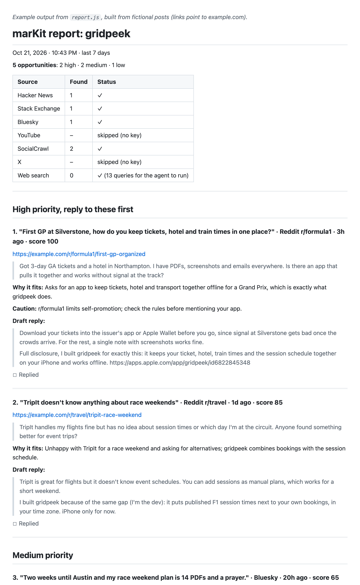
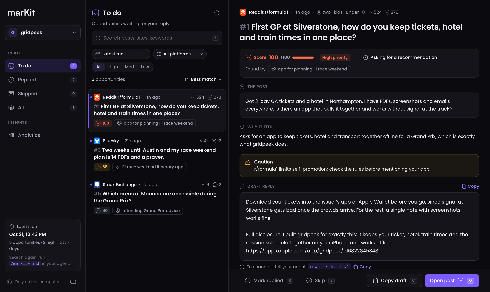

<p align="center">
  <picture>
    <source media="(prefers-color-scheme: dark)" srcset="docs/brand/logo-dark.svg">
    
  </picture>
</p>

**Find the people already asking for your app.** marKit is a free, open-source agent skill for [Claude Code](https://claude.com/claude-code) and Codex that helps indie founders market their apps honestly.

It finds online posts where people:

- **ask for a recommendation** ("what app do you use to plan your F1 race weekend?")
- **complain about a competitor** ("TripIt keeps losing my bookings, any alternatives?")
- **describe a problem your app solves**
- **mention your app directly**

For each match, marKit explains **why it fits**, scores it, and **drafts an honest reply**, all in one organized report. **marKit never posts for you.** You read the drafts, edit them, and reply yourself.



<sub>Example built from fictional posts. See the full [example report](docs/example-report.md).</sub>

---

## How it works

```
/markit-find
   │
   ├─ search.js     searches Hacker News, Stack Exchange, Bluesky, YouTube, Threads, X, SocialCrawl (Reddit)
   │                with YOUR keys, removes posts you've already seen  → raw.json
   ├─ your agent    runs web searches (forums, Q&A)                    → web.json
   ├─ candidates.js drops old, excluded, other-language and duplicate posts, pre-scores
   │                the rest, keeps the top 40, and checks the top 15 threads
   │                (solved? locked? apps already suggested?)          → candidates.json
   ├─ your agent    scores only those candidates, drafts replies
   │                (rules in references/scoring.md and reply-guide.md) → scored.json
   └─ report.js     validates everything, writes the report               → report.md + cards.json

/markit-dashboard   a local page (127.0.0.1 only) to filter cards, copy drafts, open posts,
                    and mark each one Replied or Skipped
```

Everything runs on your machine. There's no marKit server, no account, and no telemetry.

### The dashboard

`/markit-dashboard` opens a local page for working through the results: filter, read why each post fits, copy the draft, open the post, and mark it Replied or Skipped. Keyboard shortcuts: <kbd>J</kbd>/<kbd>K</kbd> to move, <kbd>R</kbd> replied, <kbd>S</kbd> skip, <kbd>C</kbd> copy, <kbd>O</kbd> open. It also has an Analytics view.



<sub>Fictional example data.</sub>

## Requirements

- [Node.js](https://nodejs.org) **20.12 or newer**
- Claude Code or Codex

## Install

**Recommended:** with the open [`skills`](https://skills.sh) installer (works for Claude Code, Codex, and 70+ other agents):

```bash
npx skills add https://github.com/notsocj/markit --skill '*' -g
```

It asks which agents to install to; choose **Symlink (Recommended)**. Or, in one go for Claude Code:

```bash
npx skills add notsocj/markit -g --skill '*' -a claude-code -y
```

- **`--skill '*'` matters.** marKit is four skills (`markit-setup`, `markit-find`, `markit-usage`, `markit-dashboard`) that share code, so install all four together. If one is missing, marKit tells you the command to fix it.
- **Keep `-g`.** It installs for your user, so marKit works in every project. Without it, the installer asks for a scope, and "Project" installs marKit only into the folder you ran it from. Then `/markit-*` won't appear in your other projects.
- **Update:** `npx skills update -g`.
- **Remove:** `npx skills remove -g markit-setup markit-find markit-usage markit-dashboard`. Your config and keys in `~/.config/markit` stay.
- The installer puts the files in `~/.agents/skills/` and symlinks them for Claude Code. marKit works the same either way.
- The `skills` installer (not marKit) sends anonymous usage data. Set `DISABLE_TELEMETRY=1` to turn that off.

Start a new agent session afterwards so it sees the skills.

**Alternative: from a clone,** with no npm tools at all:

```bash
git clone https://github.com/notsocj/markit.git
cd markit
./install.sh
```

| Command | Installs to |
|---|---|
| `./install.sh` | Claude Code, for your user (`~/.claude/skills`) |
| `./install.sh --codex` | Codex, for your user (`~/.agents/skills`) |
| `./install.sh --claude --codex` | both |
| `./install.sh --project` | Claude Code, current project only (`./.claude/skills`) |
| `./install.sh --dir <path>` | any skills folder |
| `./install.sh --link` | symlinks to the clone (for developing marKit) |
| `./install.sh --uninstall` | removes the skills (your config and keys stay) |

`install.sh` only copies files.

## Quick start

1. **`/markit-setup`** creates your config and walks you through API keys (most sources need none). Run it **inside your app's project folder** and marKit drafts your app profile from your README, store listing, and screen names; you only add competitors and confirm.
2. **`/markit-find`** searches, scores, drafts, and writes the report. Run it in your project folder and it picks the right app automatically.
3. **`/markit-dashboard`** opens a local page to work through the cards: filter, copy a draft, open the post, mark it Replied or Skipped.
4. **`/markit-usage`** shows which sources are ready and how much quota or credit you've used.

In Codex, use `$markit-setup`, `$markit-find`, `$markit-dashboard`, `$markit-usage`.

## Commands

| Command | What it does |
|---|---|
| `/markit-setup` | First run: config, keys, first app profile, key check. Later: add or edit an app, add or change a key, change limits |
| `/markit-find [app]` | Finds opportunities and drafts replies into a report. Say "rewrite draft #3" to change one |
| `/markit-dashboard` | Local page: filter by app, run, platform, priority; copy drafts; open posts; mark Replied / Skipped; stats. Rewrite drafts in chat by card number |
| `/markit-usage` | Sources ready (✓ / ✗), this month's usage against free quotas and paid caps, last run, command guide |

Reports are saved to `~/markit-reports/<app>/<date-time>/report.md`, and posts you've seen won't show up again in later runs.

## Sources

| Source | Cost | Key | Notes |
|---|---|---|---|
| Hacker News | free | none | stories and comments |
| Stack Exchange | free | optional | 300 requests/day without a key, 10,000 with a free one |
| Bluesky | free | none | public search; an app password is only a fallback |
| YouTube | free | Google API key | 100 searches/day (YouTube's limit since June 2026); finds videos |
| Threads | free | Meta token | **only searches your own posts until Meta approves your app in App Review**, so it's off by default |
| X | **paid** | Bearer token | ~$0.005 per post returned |
| SocialCrawl | **paid** | API key | the reliable way to search **Reddit**; 100 free credits on signup |
| Web search | free | none | your agent searches forums and Q&A sites |

Step-by-step key instructions: [`skills/markit-setup/references/setup-guide.md`](skills/markit-setup/references/setup-guide.md).

**A note on Reddit:** AI agents' web search rarely returns Reddit threads (Reddit restricts search crawlers), so without SocialCrawl, Reddit coverage is thin.

## Costs (paid sources only)

marKit works well with free sources only. If you enable a paid one, marKit stops calling it at your caps (in `~/.config/markit/settings.json`), checked against its own usage count:

| Source | Price | Default caps | Worst case at defaults |
|---|---|---|---|
| X | ~$0.005 per post (no free tier) | 30 posts per run, 900 per month | ~$0.15 per run, ~$4.50 per month |
| SocialCrawl | 1 credit per keyword search; 100 free credits, then from £15 / 2,500 credits | 50 credits per run, 1,500 per month | a typical run uses 5–8 credits |

Thread context (reading a post's replies) is **off for paid sources** by default. Set `"contextForPaidSources": true` in `settings.json` to allow it; it still stays inside the caps above (X: billed per reply returned; SocialCrawl: 5 credits per Reddit comment page). `maxCandidates` (40) and `maxContext` (15) in the same file control how many posts your agent judges and how many threads get checked.

**Also set a spending limit in each platform's own console** (X: console.x.com). That's your hard safety net; marKit's caps are a second one. `/markit-usage` shows this month's spend estimate and warns near a cap.

## Privacy and security

marKit follows six hard rules:

1. **No browser automation.** Only official APIs, your own keys, and your agent's web search. No scraping, no logged-in browser sessions.
2. **Never posts for you.** No posting, replying, liking, following, or DMs. It only drafts.
3. **Your agent never sees your API keys.**
   - Keys live in `~/.config/markit/.env` (Windows: `%APPDATA%\markit\.env`), created with owner-only permissions (`chmod 600`), outside the skill folders.
   - Only marKit's scripts read that file. Every skill tells the agent never to open it or ask you to paste a key into chat, and lists the default path under `disallowed-tools`. For a guaranteed block in Claude Code, add the [deny rule below](#optional-a-claude-code-deny-rule-for-your-keys-file).
   - Keys never appear in output, logs, reports, errors, or JSON. Network errors say only `<source>: HTTP <status>`, never the URL or headers. Status checks show ✓ / ✗ only, never a key or part of one.
   - `.env` is the **only** place keys come from. A key exported in your shell (e.g. an `X_BEARER_TOKEN` for another project) is ignored, so marKit can't bill the wrong account.
4. **Posts are untrusted data.** Text from posts, comments, and web pages is analyzed, never followed as instructions. Titles and excerpts are escaped in reports, so a post can't inject links or HTML, and control characters are stripped from terminal output.
5. **Zero npm dependencies.** Only Node.js built-ins, so you can read every line before installing.
6. **No remote server, no telemetry.** marKit only talks to the APIs you enable. (The dashboard is a server on your own computer, reachable only from it.)

### Optional: a Claude Code deny rule for your keys file

The skills already tell the agent never to read `.env`, and each skill blocks it while that skill runs. For a second layer that applies **all the time**, add a permission deny rule to your Claude Code user settings, `~/.claude/settings.json`:

```json
{
  "permissions": {
    "deny": ["Read(~/.config/markit/.env)"]
  }
}
```

If the file already has a `permissions.deny` list, add the line to it. `~/` means your home folder (on Windows, with the default config location, use `Read(~/AppData/Roaming/markit/.env)`).

What it does, per [Claude Code's permission docs](https://code.claude.com/docs/en/permissions):
- **Blocks:** Claude's file tools, plus shell commands Claude Code recognizes as reading that file (`cat`, `head`, `tail`, redirects like `< .env`).
- **Doesn't block:** a program that opens the file itself. That's why marKit's scripts keep working: they run as their own process and read the keys directly.

For OS-level enforcement against every process, use Claude Code's [sandbox](https://code.claude.com/docs/en/sandboxing).

When drafting a profile from your project, `setup.js scan` builds the reading list **in code** and never lists `.env` files, keys, certificates, credentials, `node_modules`, build output, or lock files.

Your config folder holds `apps/*.json` (profiles), `settings.json` (limits), `seen.json` (post IDs already reported), `usage.json` (counts only, never keys or post text), and `status.json` (cards you marked Replied/Skipped).

**The dashboard** is a zero-dependency local server that:
- binds to `127.0.0.1` only and rejects any request whose Host isn't `localhost:<port>` / `127.0.0.1:<port>`, which blocks DNS rebinding
- only reads the reports folder. From the config folder it reads `settings.json` once at startup (to find the reports folder) and otherwise only touches `status.json`
- accepts exactly `{ id, status }` (same-origin JSON, under 1 KB) to save a status
- shows post text as plain text under a strict Content-Security-Policy
- stops after 30 minutes without use

## Honest replies

The drafts follow [`reply-guide.md`](skills/markit-find/references/reply-guide.md): help first, **always disclose that you made the app**, mention an alternative when natural, keep it short, no hype, and only claim what your app really does. Many communities ban self-promotion. marKit flags those with a caution, and you decide whether to reply at all.

## Development

```bash
npm test          # node:test, no dependencies; tests never touch the network or your real config
./install.sh --link   # symlink the skills, so edits in this repo apply immediately
```

- Contributor notes and conventions: [`CLAUDE.md`](CLAUDE.md). Full design: [`MARKIT_SPEC.md`](MARKIT_SPEC.md).
- Shared code lives in `skills/markit-find/scripts/lib/` and `adapters/` (one file per source).
- Set `MARKIT_CONFIG_DIR` to use a different config folder (the tests do this).
- **Never run `npx skills add` or `npx skills remove` without `-g` inside this repo.** The installer treats the repo's `skills/` folder (marKit's source code) as an install location, so a project-scope remove deletes `skills/markit-*`. If that happens, restore it with `git restore skills/`. For development, use `./install.sh --link`.

**Maintainers:** enable GitHub **secret scanning** and **push protection** for this repository (Settings → Code security), so a key can never be pushed by accident.

## Credits

- Icons: [Solar](https://www.figma.com/community/file/1166831539721848736) by 480 Design ([CC BY 4.0](https://creativecommons.org/licenses/by/4.0/)) and [Simple Icons](https://simpleicons.org) for platform logos (CC0), embedded as SVG.
- Dashboard font: [Poppins](https://github.com/itfoundry/Poppins) by Indian Type Foundry ([SIL Open Font License 1.1](skills/markit-dashboard/scripts/fonts/OFL.txt)), bundled so the page loads nothing from the internet.
- The marKit logo's wordmark is set in Satoshi (Indian Type Foundry) and converted to outlines. No Satoshi font files are included.

## License

[MIT](LICENSE)
